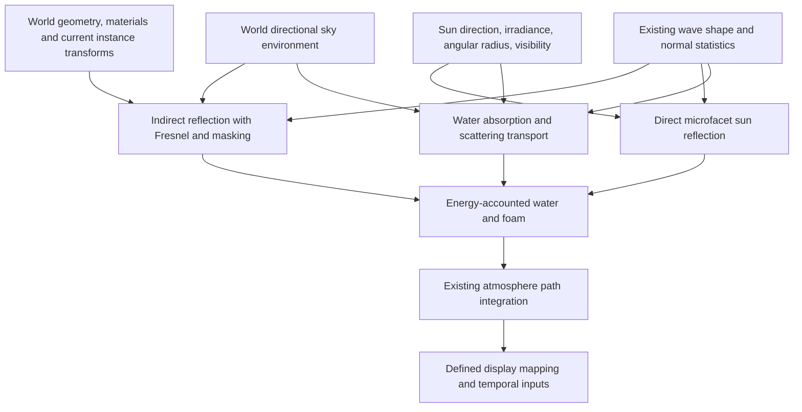

# Water lighting and reflection architecture

Current implementation order: [WATER_REFLECTION_PLAN.md](WATER_REFLECTION_PLAN.md), 28 small acceptance-gated
steps requested by the owner after accepting the black-band fix. The findings/binary hashes below describe the
original audit, not today's installed state. The 896F21FA... hash identifies the accepted November 1 baseline.
World-source object/shore paths have since landed in steps18/19; step20 and later gates remain open.
See [STATUS.md](STATUS.md), the active plan and JOURNAL.md for current conclusions and dated receipts.

2026-11-01. Architecture audit and replacement design; implementation IN PROGRESS after owner approval. This supersedes the
painted-sky highlight approach in the earlier water notes. The owner accepts the current wave geometry and
requests a fundamental lighting/reflection review. Preserve their spectrum, dimensions, displacement and phase
controls. Do not use another collection of sliders to hide missing illumination data.

Owner rejected the first lighting preview: the retained projected object lookup still causes white borders,
pitch-dependent changes and hull-color leaks; black streaks also expose invalid/masked water directions. Partial
positive-ray/contact fixes and a world image-shaped cloud emitter are installed in BOTH labs (9EB96D6C...).
They do not complete this design. The native draw-source ABI and independent geometry-BVH query core are in
development; complete native material/pose/coverage collection and production water integration remain pending.
For this painted backdrop, a lens-flare direction is not proof of a visible naked solar disc: use the captured
cloud opening's directional profile with an explicit estimated irradiance scale, not a point source or global
bright-cloud amplification. Actual GPU profile/power/support and moving-occluder query-core tests are recorded
in build/water-artifacts-20261101. Numeric passes do not supersede the owner's rejected visual verdict.

## Findings in the audited November 1 implementation

| Component | What it actually does | Consequence |
|---|---|---|
| `river_water.cpp::PlaceReflection` | Mirrors the main camera with its existing pitch/frustum, one water plane | Coverage follows the observer's framing; it is not a full directional environment |
| SDK `WaterFollowReflection` | Marches the reflected camera's linear depth; a miss returns an edge UV and `sky=true` | Missing scene data is mistaken for visible sky; clamped reads can stretch unrelated border radiance |
| Same tracer | Forces ray forward depth and projected `w` positive with `max` | Backward/parallel directions are treated as a different forward ray instead of rejected or clipped |
| `CsPaintedSky` | Expands neutral bright pixels throughout the captured sky, then adds an angular solar gain | Broad clouds become a strong highlight even outside the sun's support |
| `PsWater` | Integrates seven unresolved facets, using that finite texture for both sky and objects | More samples cannot supply missing sky/objects; screen-dependent coverage remains |
| Direct sunlight | SDK `WaterGlitter` exists but has no caller in the water material | There is no independent direct-sun microfacet evaluation in the current material |
| `WaterBody` call | Uses the material color times light and `1-exp(-effectiveExtinction*path)` | Body radiance survives zero particle scattering; turbidity does not control the source of scattered light |
| `WaterSunScatter` and final blend | The solar helper includes exit transmission, then is added inside the body multiplied by the outer transmission share | The resolved-facet exit Fresnel is applied twice (outer share is the integrated/artistic one) |
| Crest transmission | Invents the opposite face by mirroring a slope, with a uniform virtual depth | It is a wedge approximation, not transport through the displaced wave's actual thickness |
| Radiometry | Native scene is LDR; selected water sky pixels get up to 16x, solar gain on top | No common exposure/incident-light calibration; encoded values above display range can clip on presentation |

This is a planar rendered reflection, not main-camera SSR: LS3D really draws the scene again. Its lookup/tracing
nevertheless operates in one finite projected image and inherits missing-coverage/disocclusion problems.
FOV ownership was fixed separately and must remain intact. Fresnel itself is already dielectric and angle
dependent; adding total internal reflection above water cannot fix these problems.

The current source-only scene-radiance patch mildly expands reflected objects and gates solar gain separately
from receiver shadows. It does not solve directional coverage, direct solar BRDF or the volume source term.
It is not a replacement architecture and was not deployed during this audit.

## Evidence and confidence

Local evidence: `build/water-lighting-audit-20261101` (ignored, no game assets in Git). The lab was stopped at
entry; 1.2 was launched explicitly. Saved source/config preimages before diagnostics. Inspected native images
with DLAA kept off (the owner's current preference), mission time held and integrated wave speed zero: same geometry/settings/phase, changing
only camera pose. The existing restore point contains police; the first attempt reached the native arrest menu,
and a restore request while that menu was open timed out. Retried through its known Retry control before capture.

`native-camera-evidence.json` contains four fresh reflection/camera snapshots and native screenshot paths:
over open water, depression 10/45 degrees at the same eye/yaw; then towards the actual visible sun, 10/45 degrees.
Native images show excessive broad bright water towards the sun. They do not establish a measured 180-degree
angular extent; that number remains the owner's description, not a measured radius.

Restored the three touched preference files to their exact byte preimages, released the diagnostic camera and
time hold, and closed only the 1.2 lab launched for this audit. Fresh status confirms both labs stopped, as at entry.

Projecting fixed world directions through the native reflection matrices gives this coverage counterexample:

| World ray elevation, same azimuth | Camera down 10 degrees: UV.y | Camera down 45 degrees: UV.y |
|---|---:|---:|
| 5 degrees | .4005, covered | -.4546, outside |
| 30 degrees | .9141, covered | .1952, covered |
| 60 degrees | 1.8559, outside | .8049, covered |

These are the same world-space directions, independent of camera pitch. A finite texture cannot answer all
of them, and sampling its edge is not the missing illumination. This proves a coverage defect, without claiming
it explains every reported artifact. Raster footprint, contact repair, fog and temporal reconstruction can
contribute separately. The artifact family is present without DLAA, so DLSS is not a necessary cause.

The source curve expands a linear neutral .9 cloud by 16x. At the owner's glitter .202603, the extra solar gain
can reach 4.241648 on top. The default angular support is 18 degrees (outer radius), compared with the real
sun's approximately .266-degree angular radius. The global cloud expansion has no angular support at all.
These are source-equation diagnostics, not measurements of physical scene radiance.

For a unit-lit body, color channel 52/255, absorption 1/m, path 10 m and zero particle scattering, the current
body equation still yields .030255 linear radiance. There is no bed term in this example. That demonstrates the
incorrect source dependence; zero scattering need not make a real water pixel black if a real bed is transmitted.

The existing actual WARP tests still pass. They check local shader math and synthetic in-frustum tracing, not
world-direction invariance across capture frusta or a physically coupled volume source. Historical 15 checks per
build/full offline results are genuine but do not constitute lighting acceptance.

Installed water in BOTH labs remains `C4386058E495479B96F30126955DF6A11C3B412B991FD095EB9F086FE1FCFC09`.
The pending source-only build is `E4FAB6423570F90ACDC086C0C704EF62358C2B3E85EDA5E099C11FA47F0302CC`.
No shader/host binary was deployed by this audit. Both-build runtime acceptance of the replacement is pending.

## Replacement structure

### 1. Separate sky illumination from projected scene reflection

Provide a reusable host/SDK directional environment, with a defined linear radiance convention, world-oriented
cube faces/mips, validity, generation and frame/scene ownership. Capture the actual native backdrop without
foreground geometry or flares; camera tilt must not change the environment. Do not construct it from whatever
sky remains visible in the current water reflection. Refresh on scene/backdrop/lighting changes, not on observer
pitch; animated backdrops need an explicit update policy and coherent publication of all faces.

Use native Render's selected backdrop pass and scene-view restoration contracts
when implementing the service. A new MML_VIEW_SKY_ONLY capability and SDK environment helper are being tested;
do not hide the city with a huge clip plane, move the capture eye far above the world, or render the whole city
six times every frame. Initialization may temporarily use a documented fallback until a complete environment is
ready. Preserve native device/cache/audio/viewport state and release resources on owner unload, faults and reset.

Owner clarification: pitch was only one example; passing barges and other occluders must be part of the design.
A wider planar image, parallax-corrected cube or local depth probe remains a single visible layer. It cannot
recover the background hidden by a moving hull, even with perfect projection math. These are not the foundation
of the replacement. A sky cube supplies infinitely distant sky only, never missing foreground geometry.

Object reflection must query world geometry/materials, independently of the main camera and of the old reflection
texture. Cache static mesh acceleration structures separately from current instance transforms; moving hulls,
doors and posed meshes require a SAME-frame update, not a stale 250 ms scenery scan. Keep material/UV/opacity
information for shading and alpha-test traversal. A nearest triangle hit followed by sampling an unrelated
screen pixel is not a complete reflection implementation. Opaque and cutout occlusion, background disocclusion,
mesh lifetime/streaming and instance removal belong to the shared renderer service.

The existing scene_pieces/actor_meshes SDK provides position/index/flags but lacks the complete material/UV and
posed-render snapshot required here. Do not silently substitute collision geometry or modify its unversioned
array stride. Extend the renderer with a versioned owner-scoped geometry/material snapshot, reusable by other
ray consumers, and a D3D11-capable acceleration/query path. CPU/GPU buffers, textures and instance transforms
must have explicit frame/generation ownership. Native fixed-pipeline material/light information must retain a
defined transfer convention. Unsupported material/geometry is incomplete scene data, never transparent sky.

Return an object hit with primitive/barycentric/material/distance information, a confirmed miss within complete
scene coverage, or unknown coverage. Test moving occluders over multiple background layers, silhouettes, hull
feet, self intersection and alpha cutouts. Data outside loaded/owned scene coverage cannot be promised correct;
report it explicitly and fix coverage instead of fading away the evidence. Planar capture may remain a comparison
or validated optimization, but must not reintroduce dependence on what one camera could see.

### 2. Evaluate the direct sun separately

The light source is its world direction, irradiance/color, approximately .266-degree angular radius and shadow
visibility. Evaluate dielectric Fresnel, a normalized microfacet distribution and Smith masking/shadowing using
the existing resolved normal plus unresolved slope statistics. Include finite solar-disc/pixel filtering without
using an 18-degree cloud cone as the sun. More roughness can broaden a real glitter path; it must not turn the
whole forward hemisphere into a constant highlight. No camera-texture edge is a light source.

Retire the cloud inverse-tone/solar multiplier as the source of direct sunlight. Keep reflected cloud structure
in the indirect environment with an explicit, scene-consistent exposure calibration. An LDR painting cannot
recover measured HDR radiance; label that conversion as an artistic assumption. Avoid double counting a solar
disc if a future environment actually contains one. Do not just call the old `WaterGlitter` unchanged: it lacks
a complete masking/visibility convention and its numerical/filtering limits need validation.

For water, use one chosen visible-sun direction consistently for the direct BRDF, solar volume illumination and
its shadow request. Retain the legacy world's scene-light direction for compatibility with native materials,
but do not silently mix its elevation into the water's solar irradiance. Night/below-horizon/absent-sun cases
must produce no direct solar term; cloud attenuation is a lighting input, not guessed from one screen texel.

### 3. Replace the body color approximation with coupled medium transport

Represent absorption `sigma_a` and scattering `sigma_s` in 1/metre, with a defined phase function. Extinction is
`sigma_t = sigma_a + sigma_s`. Compute scattered radiance from `sigma_s * phase * incidentLight` integrated with
Beer-Lambert attenuation along incident and outgoing paths. Sky and direct-sun terms share units and geometry.
A reduced scattering coefficient can be used for a documented multiple-scattering approximation, not substituted
silently into the single-scattering extinction. Preserve artist color through a documented conversion to these
coefficients rather than adding an independent unbounded colored emitter.

Apply the eye-side interface transmission exactly once, with an explicit radiance/IOR convention at both
interfaces. Integrate indirect reflection and transmission with compatible facet visibility; the current
view-renormalized seven-node quadrature is an approximation, not a complete energy-conserving microfacet BSDF.
Foam is separate surface coverage and lighting, not stronger water-body scattering.

Keep the uniform deep-water slab as an explicit first-stage approximation. True refracted bed color requires
a real opaque scene/bed hit and distance, not opaque depth behind an unrelated wall. Thin-crest transmission
requires meaningful thickness: derive a bounded approximation from the existing wave field or trace it; do not
promise actual wave-to-wave transport from the current mirrored-slope wedge. No wave geometry retuning is needed.

### 4. Define output exposure and keep temporal work separate

Compose in linear light, then use a defined highlight/display mapping compatible with the native LDR scene.
The current FP16 effect target can carry values above one, but it does not by itself supply a display transform.
Simply clipping enormous reconstructed sky values is not physically based highlight rolloff. Keep the existing
shared incoming/outgoing atmospheric path contract; do not apply the incoming leg twice or fog body separately
under a second independent model.

The queued calm-water DLSS repro remains a separate block after spatial lighting is correct. Surface displacement
motion does not generally describe reflected radiance motion. Do not claim the camera-coverage fix also solves
specular history, or discard the owner's working wave/temporal geometry integration.

## Implementation order and acceptance gates

1. **Directional environment and world geometry reflection queries.** Add host/SDK lifecycle/capture contract and CPU/WARP
   tests. Test a labeled environment with fixed world points and observer pitch/yaw/FOV changes. Uncovered rays
   must report unknown coverage; only a confirmed geometry miss reads the sky. Test real bank silhouettes,
   a moving occluder with two background depths, a controlled boat/prop trajectory and the native passing barge,
   low/high cameras, bridge contacts, scene transitions, unload/fault/reset and BOTH native builds.
2. **Direct sun BRDF and exposure.** Test a black environment with one sun: aligned, 45/90/180-degree azimuth
   offsets, sun below horizon, shadowed receiver, rough/calm water and changed camera projection. Compare the
   same world point/view direction across pitch by resampling the actual hit/depth, not the same screen pixel.
   Validate finite values, energy/masking, angular shape and highlight rolloff. Restore the painted environment
   and compare native sun/side/opposite views; no broadened white-sheet substitute.
3. **Volume transport.** WARP zero-scattering/no-bed, zero-light, absorption/color, finite/deep-slab and
   transmission-accounting cases; verify actual native pixels with isolated contribution views. Test crest
   thickness separately from deep-water color. Retain user geometry and the compact UI.
4. **Integrated appearance, cost, and temporal follow-up.** Native pitch sweeps in 1.2/1.0 with DLSS off, then on,
   diagnostic contribution views, reference comparison and paired timing/memory measurements. No six full city
   renders per frame or extra sevenfold tracing without measured benefit. Then investigate the queued calm-water
   reflection-motion/history issue. Numeric tests passing does not complete the appearance gate.

Use SDK mechanisms and small-mod artistic policy. Any new public host contract must include version/size
validation, C/C++/Rust callers, automatic ownership cleanup and restoration in both labs. These unchecked
implementation stages are the next work, not features already delivered by this audit.

## Reflection transport timing experiment (2026-11-05)

The candidate made the four transport dispatches share the first facet's soft-shadow factor. The first dispatch
calculated it with the existing PCSS taps. The transport buffer's state lane carried its float bits together with
the coverage and incomplete-scene flags. The later dispatches recovered those bits and kept the same optical
samples, path order, shadow origin and allocations. A ray that exited into the sky also shared one
directional environment read between the background and the measured cloud opening.

The candidate's `CsWaterTransport` compiled in 29.19 s and the complete x86 water target built. On the same
1.2 host at 1440x810 with DLAA temporarily off, frame median was 209.23 ms before and 208.92 ms after.
Transport GPU median was 28.99 and 29.81 ms respectively. Scene geometry counts varied slightly after restore.
The candidate was removed because the comparison did not establish a gain. An earlier experiment moving
PCSS into the path loop hit the 60 s FXC limit and was removed before deployment.

## One raster pass for transport seeds (2026-11-05)

The candidate uses D3D11 rasterizer-ordered UAVs to publish all twelve existing full-precision seed slices
in one draw sequence. A 32-bit ordered depth surface resolves overlapping fragments in submission order with
the existing less-or-equal rule. The two render-target passes remain available on other devices. The optical
sample count, seed layout consumed by compute, transport, and final composition are unchanged.

The first 1.2 comparison held one process, camera, wave phase and 248,141 scene triangles, at 1440x810 with
DLAA temporarily off. Seed GPU time was 19.39–23.08 ms in the two-pass arms and 13.95–16.55 ms in the
ordered arm. The two baseline captures agreed exactly in the water crop. The ordered captures differed in
that same crop. FXC had placed coarse derivatives after a nonuniform early return for fragments behind the
current depth. That build was removed from the lab. The revised shader discards those fragments, masking
UAV writes while preserving the quad derivatives. Disassembly confirms the discard and no conditional
return before the derivatives.

The second 1.2 comparison used the same process, fixed river view, 247,556 triangles and DLAA temporarily
off. The seed median moved from 22.143 ms across seven observations to 15.128 ms across eight. Total water
GPU median moved from 65.369 to 57.753 ms. The baseline and two ordered captures matched exactly in a
198,000-pixel water crop after JPEG quality-100 decoding. Both arms published fresh water with zero late
frames. This verifies that fixed river case. It leaves moving-water FPS and the second lab as separate gates.
The installed water candidate was `4D440F6D641E02EB9071A7D511E70690B934BC45057A54E1349C4447510DD05B`.
At 800x600 in lab 1.0 the log confirmed the ordered raster and 46 fresh water publications with zero late
frames. The observed seed and total water GPU time were 10.39 and 37.59 ms, compared with 19.03 and 48.10 ms
in the previous separate run. The 43-frame moving sample averaged 4.76 FPS. The end-to-end samples used
different runs, so they do not establish a whole-frame gain.

The ordering and discard behavior are specified in the [D3D11 ROV overview](https://learn.microsoft.com/en-us/windows/win32/direct3d11/rasterizer-order-views)
and [D3D11 functional specification, section 16.13](https://microsoft.github.io/DirectX-Specs/d3d/archive/D3D11_3_FunctionalSpec.htm).

The next transport candidate initializes draw-depth history only after the first accepted layer that
leaves transmission. The deduplication loop reads the occupied prefix. The existing WARP fixture passes
the ordered layers, coplanar ties, cutout depth, footprint, and 32-layer bound with this change.

## Full-precision DXR interop probe (2026-11-05)

The same-adapter standalone probe uses Direct3D 11 to fill a Direct3D 12-owned shared texture. The D3D12
queue waits for the producer fence, copies it on the GPU, and signals the D3D11 consumer. The final CPU
readback is only for verification. On the RTX 3070, 1440x810 R32_FLOAT textures opened and matched every
pixel for one and four array slices, with and without UAV binding. R32G32B32A32_FLOAT returned
`E_INVALIDARG` in `OpenSharedResource1` in the same matrix. The local source is
`build/water-30fps-20261104/dxr_shared_water_probe.cpp`.

R32_FLOAT planes can carry the current float components without quantization. The remaining cost is the
layout and GPU handoff for the full seed and result sets, plus same-frame acceleration, materials and
billboard queries. The probe only verifies resource compatibility and fence ordering. It supplies no
production ray transport or FPS result. See [D3D11 shared-resource tiers](https://learn.microsoft.com/en-us/windows/win32/api/d3d11/ne-d3d11-d3d11_shared_resource_tier)
and [D3D12 shared handles](https://learn.microsoft.com/en-us/windows/win32/api/d3d12/nf-d3d12-id3d12device-createsharedhandle).

The existing software transport shader also compiled as `cs_6_5` DXIL in about one second using DXC
`-HV 2018`. The SDK's compiler default rejected the legacy vector ternary and logical operators.
This compile uses the software intersection path. The next DXR comparison must preserve source draw ties,
native cutout/mip evaluation, explicit unknown coverage and ray-dependent billboard orientation.

The RTX 3070 creates an x86 D3D12 device, but its feature query reports DXR tier 0. The x64 query on the same
adapter reports tier 1.2, so this machine requires the x64 sidecar for hardware traversal. The x64 standalone
`build/water-30fps-20261104/dxr_aabb.cpp` routes procedural AABB candidates through the existing SDK triangle
intersection function. It matched deterministic coplanar ties, nearest selection in both directions, a rejected
candidate with a deeper hit, and a miss. This small fixture does not measure performance. The procedural route
can preserve the existing barycentric and distance arithmetic while the driver accelerates candidate selection.
See [DXR inline candidate control flow](https://microsoft.github.io/DirectX-Specs/d3d/Raytracing.html).

The full `CsWaterTransport` shader also compiles to Shader Model 6.5 with the scratch
procedural traversal adapter. DXIL contains `RayQuery_TraceRayInline` and the candidate
instance/primitive queries. The adapter uses the existing stored object inverse, triangle
test and ordered material logic. Billboard candidates still perform per-ray facing.
This is a compile gate. Same-frame sidecar publication, full-scene parity and GPU timing
remain unverified.

A synthetic x64 geometry load in `build/water-30fps-20261104/dxr_load.cpp`
checks 1,166,400 rays, 10,031 instances and 160,496 logical triangles, including
coplanar source-order ties, rejected candidates and unknown coverage. With conservative
procedural boxes, committing an accepted exact distance lets DXR prune farther candidates
while the shared narrow phase still resolves ties. The 32-byte results matched the software
compute shader bit for bit. The DXR dispatch took 0.64–0.65 ms with the committed distance
and 1.69–1.97 ms without it. Software took 1.17–1.78 ms. These timestamps exclude the
acceleration-structure build, native materials, sharing and the rest of water transport.

The same traversal also compiles the full transport to Vulkan 1.2 SPIR-V with
the pinned SPIR-V-enabled DXC. The RTX 3070 x64 Vulkan driver exposes ray
queries and acceleration structures. Its x86 driver does not. In
`build/water-30fps-20261104/vk_water_shared.cpp`, an independent x64
Vulkan device imports legacy KMT D3D11 memory at the same adapter LUID.
GPU timeline ordering and external queue ownership give exact two-way
readback on 1440x810 `RGBA32_FLOAT` storage images with three and four
slices. Shared 8192- and 16384-square `R32_FLOAT` textures match in a
64x64 corner sample without a full-image copy. This supports sharing the
existing seed precision and map extents with a Vulkan sidecar. The same
fixture's x86 native process and x64 Vulkan child passed a bit-exact
four-slice 1440x810 roundtrip. The child inherited only the shared
timeline handle. The game integration still needs per-frame publication
and native scene/transport parity.

The synthetic geometry dispatch also ran as Vulkan SPIR-V. In three
device-local runs the shader measured 1.37–2.03 ms for software traversal
and 0.42–0.65 ms for ray queries, with bit-exact results in every run.
These times omit staging readback. The first host-visible storage-buffer
comparison took tens of milliseconds and is not the intended GPU path.

A separate 17-case material fixture used the exact D3D11 buffers for
both WARP and the Vulkan ray-query path. All 68 rays matched status,
layer count, instance and distance, including native mip alpha and
coplanar transparent draws. The largest absolute error in linear
radiance or transmission was 4.47e-8. Live transport and frame
publication are still separate gates.

## DXVK shadow and bridge timing (2026-11-05)

The optional `gfx.state` stage timestamps distinguished the late receiver-fitted shadow path from the
early native shadow pass. At 1440x810 with DLAA, one control window had 69 live frames and zero late
publications. The slowest D3D9 queue span was 743.82 ms. It included 60.35 ms for late receiver preparation,
29.16 ms for the shadow draw, 101.70 ms between shadow draw and the CPU fence, and 513.05 ms after that fence.
CPU submit samples were below 0.35 ms in either direction, with no measured ring or completion wait.

The DXVK GPU-fenced path now uses the existing `To11` ordering for the late shadow map. The D3D11
consumer still receives the map drawn that frame. A failed map transfer fails that bridge frame instead of
binding the previous map. The CPU-waited paths retain the D3D9 wait. The candidate 1.2 host `7E4768FB`
published 70 fresh water frames and 69 DLAA frames in a 71-frame live window with zero late frames and
an active 8192 or 16384 shadow map. Mean Wait9 was 0 ms versus 22.14 ms in the control, and the timed
late shadow fence interval was 0 ms in the slowest sample. The post-shadow span still reached 515.13 ms.
This host also included the native FVF tracker. The separate runs do not isolate an overall FPS gain.

The DXVK queue's own timestamp pair then measured up to 178.008 ms inside the transfer submission for one
16384x16384 R32F shadow map. One ordinary three-texture 1440x810 submission measured 0.049 ms, and the
observed return direction peaked at 0.105 ms. These are command spans that can include dependencies. The
corresponding CPU-side calls stayed below 1 ms. The map remains full size and precision. An aliasing proof
will determine whether both APIs can use one map allocation with the same synchronization contract.

## Shared DXVK shadow map (2026-11-05)

The host now creates the R32F map in native D3D11 and imports it as the render target in DXVK's D3D9.
The Vulkan queue releases and reacquires the same image around the D3D11 pass using external queue ownership
and the existing GPU fences. The depth attachment stays native to the caster pass. An incompatible allocation
uses the existing copy path. A map with no casters represents full visibility without publishing the clear.
The standalone probe drew two successive maps, checking 1280 texels per frame across five locations on both
8192 and 16384 maps without an intermediate CPU wait.

At 1440x810 with DLAA in 1.2, host `A1FB07CE` held an active shared 16384 map with zero late frames. In the
same saved camera setup the control averaged 5.06 FPS (82 frames, median 134.57 ms, p95 362.97 ms), and the
shared map averaged 7.41 FPS (85 frames, median 135.31 ms, p95 152.12 ms). The largest measured transfer was
now 1440x810 and the slowest forward Vulkan transfer was 0.051 ms. With DLAA off and the wave clock fixed,
the matched JPEGs differed by at most five RGB levels at the 99th percentile of the lower-right water crop.
Restarting the game also changed some live scene geometry, so this is a visual comparison across runs.
In the 1.0 native D3D9Ex compatibility check the copy path bound a 4096 map and published 47 fresh water
frames without late bridge frames. The two labs ran separately.

An opaque-only caster shader kept the same depth and slope bias while dropping the texture-stage alpha
evaluation when D3D9 alpha testing was disabled. In a fixed 1.2 A/B/A at 8192 with DLAA off, all arms
drew 12,367 casters including 1,627 cut-outs. The 198,000-pixel water crop matched exactly. Late shadow
GPU medians were 11.73, 11.06 and 11.51 ms, and total FPS was 9.52, 9.54 and 9.51. The extra shader
was removed because whole-frame throughput was indistinguishable in this test. See the [D3D9 alpha test state](https://learn.microsoft.com/en-us/windows/win32/direct3d9/alpha-testing-state).

## Composition from the ordered water surface (2026-11-05)

The ordered resolve reuses the selected seed fragment's full-precision optical frame, world position
and view direction. The same ordered write retains its depth, depth/motion output and whitecap Jacobian.
The four transport dispatches and material evaluation stay the same. The final triangle shades those pixels
without tessellating and solving the visible wave surface a second time.

On water `169D8260` in 1.2 at 1440x810, the fixed A/B/A matched 198,000 water-crop pixels exactly with
DLAA off. Compose GPU medians were 10.21, 0.27 and 9.83 ms. Total water GPU medians were 46.90, 35.85
and 47.53 ms, while frame medians stayed near 97.8 ms. The moving DLAA arms produced 7.28, 7.20 and
7.28 FPS with no late bridge frames and advancing temporal output. The 1.0 fixed comparison at 800x600
matched all 76,800 water-crop pixels.

The 1.2 DLAA validation rendered both paths from the same live frame into separate RGBA32F temporal
targets. Coverage, depth and motion matched bit-for-bit in three river views with 337,841, 364,278 and
398,908 covered pixels, all carrying nonzero motion. The 1.0 native configuration does not allocate a
temporal target and was verified through its color path. The validator was removed after capture.

Resolve is enabled by default for ordinary water on ROV-capable devices in `789CB90D`. Devices or
diagnostic modes without that path keep the original composition. Both labs received this build and
ran separately. The 1.2 moving DLAA smoke measured 9.88 FPS and 114.50 ms p95 with 73 fresh water
draws and no late frames. Its water GPU span was 34.91 ms, including 0.289 ms for compose. The native
1.0 smoke published 58 fresh water draws with no late frames, 0.193 ms for compose, and an active
4096 shadow map. It averaged 7.79 FPS in a separate live scene without a matching restore point.

## Remaining hardware transport gates

The 32-bit Vulkan driver was queried directly on this machine on 2026-11-05.
It exposes buffer device addresses, timeline semaphores and scalar layouts,
but reports rayQuery=0 and accelerationStructure=0. Hardware execution
therefore requires an x64 half on this system.

The fixture uses the actual current native city publication, including
its affine placements, billboards, alpha textures and native ordering.
A temporary one-shot capture exports live D3D11 buffer views through a
1 MiB staging allocation with each chunk aligned to the source stride.
The first unaligned attempt was rejected by structural checks before use.
Both native build datasets are ignored local diagnostics and are not a
runtime transport mechanism.

A scalable candidate can build one hardware AABB per placed source from
the already computed conservative world bounds. The exact stored inverse
and the existing local mesh query still decide triangles, alpha and ties.
This avoids thousands of native per-mesh acceleration-structure builds.
On the captured 1440x810 frame, software and hardware Vulkan traversal
match all 3,499,200 float4 transport vectors bit-for-bit. Warm transport
timings are 23.190/15.427 ms, including the existing four samples.
The full original sampler contract exposed a separate cross-API issue.
Integer mip samples and shadow results match, but fractional explicit
mip sampling through the anisotropic cube sampler differs. Replacing
both samplers with trilinear only establishes a diagnostic control.
It is not a permitted quality optimization. Explicit Vulkan SampleGrad
did not reproduce the accepted sampling either.

A D3D12 DXIL probe with the actual cube and original anisotropic sampler
matches D3D11/FXC exactly at the same fixed directions and fractional
LOD values. Full D3D12 transport then gives 18.239/12.576 ms software/
hardware and exact software/hardware vectors. Against native FXC, only
1,004 components exceed 2e-5, but a rare reflection color differs by
0.04450 and one first-hit distance differs by 111.94 m. The compiler
arithmetic/edge sensitivity gate remains open. No hardware renderer
has been installed into a lab. Both standalone backends currently use
x64 diagnostic uploads and are not production resource-transfer paths.

Without forced IEEE-strict DXC arithmetic, the full D3D12 fixture gives
18.101/12.356 ms, still exact between software and hardware. The large
first-hit discrepancy disappears, with a maximum distance difference of
0.00349 m against FXC. Rare color differences remain, at most 0.03997.
This favors D3D12 for preserving the accepted sampler behavior, but the
remaining arithmetic differences still require final image validation.

Resource sharing depends on the creator direction. The earlier D3D12-
created RGBA32F texture could not open on D3D11. D3D11-created NT-shared
textures open on D3D12 for R32_UINT, R32_FLOAT, RGBA32F, RGBA16F and
typeless BGRA. They require the keyed-mutex flag. D3D11 accesses must
acquire and release that ownership explicitly before the other device
uses the allocation. Omitting this blocked the first isolated fixture.
Its retained game inputs were transferred to a fresh helper before the
blocked process was terminated, with an identical sampled texture hash.
The corrected R32_UINT proof passes two sequential 1440x810x4 frames,
4,665,600 words each, including arbitrary float/NaN encodings as integer
data. GPU fences order 11 input, 12 copy and 11 result. CPU readback waits
only after that complete GPU chain is queued and has a bounded timeout.
The same two-frame roundtrip now passes RGBA32F seeds at 1440x810x4,
RGBA16F wave fields at 256x256x3 with all nine mips, the BGRA sky at
512x512x6 with all ten mips and the full 8192x8192 R32F shadow. The shared
sky transfer allocation is a six-layer array, since creating that NT
resource with the D3D11 cube flag fails. D3D12 supplies its cube SRV.
Replacing all eight captured image uploads with these GPU-shared copies
keeps the full transport comparison unchanged, at 17.968/12.147 ms.
The next fixture also packs existing D3D11 structured buffers into shared
R32_UINT atlases through a raw GPU copy and a bounded compute dispatch.
D3D12 unpacks them into structured/constant buffer resources. Every bit
of all 23,406,202 words in 21 captured bindings matches its original.
Full transport remains unchanged at 17.532/11.705 ms. Initialization of
the ignored fixture still recreates original D3D11 buffers from the local
capture. Production needs live buffers, reuse for verified immutable
allocations, cross-process lifecycle and same-frame output acknowledgement.

The complete isolated return path now packs each 3-float4 transport pixel
into a shared three-layer RGBA32F array. D3D11 unpacks it into its original
structured-buffer layout. All 3,499,200 float4 vectors per arm are exact
in two consecutive executions. A shared GPU timeline orders input ready,
output submitted and native consumed. The native output wait is queued
only after a successful D3D12 submission and signal. Intermediate CPU
readback is absent. Diagnostic verification waits after the complete
GPU chain. The 749 FXC/DXIL comparison outliers are unchanged. Production
resource lifetime, cycle acknowledgement, recovery and final image
comparison remain open.

A second actual 1.2 capture retains the exact resolve surface and depth.
The original FXC PsWaterResolve combines each transport result with the
same remaining inputs. Of 337,754 covered pixels, 34 differ, only two by
more than 1/255, with maximum 16/255 and full-frame mean maximum-channel
error 0.0000463/255. Coverage and status remain identical. This isolates
the rare compiler differences in final color. Moving native integration
and lifecycle validation remain necessary before enabling the backend.

The production SDK relay now has separate owner-scoped D3D11 producer and
D3D12 consumer helpers. A fixed 4,064-byte request carries descriptions,
samplers, owner/cycle/frame/generation, NT handles and fence values. The
producer retains published allocations while pending. Only explicitly
immutable SRVs reuse word payloads. Physical allocation ids are separate
from content revisions, so changed logical payloads can reuse sufficient
capacity without recreating shared storage. A Submitted reply requires successful execution enqueue
and output fence signal. Rejected certifies that no consumer GPU work was
submitted. Native output waits require the exact matching request identity.
The live mod is connected behind an unsaved opt-in diagnostic. It retains
the full native software fallback and remains disabled by default.

Live profiling found driver waits in zero-timeout keyed-mutex acquisition.
The producer now acquires ownership once per allocation and orders cross-API
access with GPU fences. Input publication can defer its flush until native
output unpack is queued, preserving the same dependency chain in one flush.
Fallback flushes outstanding inputs too. A bounded 20 ms preceding-consumed
wait prevents immediately repeating the software path for an in-flight frame.
The exact cross-process fixture passes these changes. Preliminary native
1440x810 DLAA river output is 11.59 FPS / p95 90.53 ms, with producer CPU
about 1.2 ms instead of 33 ms. Paired timing and both-build native visual and
lifecycle gates remain open. Hardware transport is not yet the default.

The SDK cross-process test passes four consecutive frames from a 32-bit
D3D11 producer through a 64-bit D3D12 consumer and back. It checks mutable
images/constants, unchanged and replaced immutable views, stale-generation
replies and generation restart. Each frame has 24,576 exact float4 outputs
and 32,768 arbitrary integer input words, with no intermediate CPU transfer.
The SDK DxrScene builds its world AABBs on the GPU from the current instance
buffer. Against the complete captured city, all 3,499,200 software/hardware
transport vectors still match exactly, with the same final-color difference.

On this system, the same RTX 3070 adapter reports raytracing tier 0 to
the x86 D3D12 device and tier 12 to x64. This is an observed capability
result, so the production hardware worker belongs in the existing x64
sidecar. Tier 0 denotes unsupported ray tracing.
[Microsoft capability enum](https://learn.microsoft.com/en-us/windows/win32/api/d3d12/ne-d3d12-d3d12_raytracing_tier).

The APIs permit different anisotropic filtering implementations. The
Direct3D sample_l instruction has an isotropic footprint, while Vulkan
leaves details of the anisotropic scheme implementation-dependent.
[Direct3D functional specification](https://microsoft.github.io/DirectX-Specs/d3d/archive/D3D11_3_FunctionalSpec.htm),
[Vulkan texture sampling](https://docs.vulkan.org/spec/latest/chapters/textures.html#textures-texel-filtering).

The proposed same-frame bridge packs GPU buffer words into shared R32_UINT
storage, preserving arbitrary integer and encoded texture bits. R32_FLOAT
roundtrips do not establish this integer-data contract. Native seeds,
wave/sky inputs and the shadow map must also retain complete precision.
A D3D11 input fence orders the x64 submission. Only an acknowledged output
submission for the same cycle may queue the D3D11 output wait. Unsupported
or failed preparation must take the existing software path in that frame.

The opt-in compact facet backend can stage upward rays. It finds the nearest hit with
the original geometric ordering and writes a small kind record. Opaque hits carry
their original barycentrics, distance, material and selected instance. Escape and
opaque shading use the original environment, footprints and material sampler.
Layered and grazing paths enter the unchanged ordered tracer on a compact queue.
The existing compact path remains available if the staged programs or buffers
are unavailable. Staging uses 28 additional bytes per pixel on the x64 GPU,
with no new transfer payload or x86 allocations.

## Model references

- [PBRT: microfacet distributions, normalization and masking](https://pbr-book.org/4ed/Reflection_Models/Roughness_Using_Microfacet_Theory).
- [PBRT: rough dielectric reflection/transmission and transport conventions](https://pbr-book.org/4ed/Reflection_Models/Rough_Dielectric_BSDF).
- [NVIDIA GPU Gems: water geometry and environment reflection](https://developer.nvidia.com/gpugems/gpugems/part-i-natural-effects/chapter-1-effective-water-simulation-physical-models).

These establish the model structure, not the claim that the current game inputs are calibrated physical light.
